# 01 · Database Design (v1, final)

**Project:** Order-to-Audit System for a Small Food Manufacturer (NIT Tiruchirappalli Winter Internship 2026)
**Status:** Approved for implementation · revision 2 (2026-11-23) · PostgreSQL 16 in Docker (≥ 14 supported)
**Supersedes:** the Phase 1 review draft. See §0 for what changed.

---

## 0. Changes since the review draft

1. **Completed production runs cannot be voided.** A run has two states, `in_progress → completed`. Mistakes are fixed with controlled corrective transactions (§9), because reversing production would silently invalidate weighted-average costs and downstream sales.
2. **Variance is split into two layers.** A numeric layer (quantity, percent, tolerance flag, cost impact) is stored or derived in the database. An operational layer (observations and wording) lives in a tested pure function. Nothing in the schema labels a variance "favourable" or "unfavourable".
3. **Integrity is specified rule by rule** (§5): typed composite foreign keys, a SQL unit-conversion function, partial unique indexes, three constraint-trigger families, and a data-driven `status_transitions` table.
4. **Valuation and corrections have a written policy** (§9). Reversals exist in exactly two places, both safe by construction.
5. **Scope trimmed:** removed run voiding, the `ctn` unit, `customers.credit_days`, and `production_runs` void columns. Added `status_transitions`. **29 tables** with `request_log` (revision 2).

### Revision 2 (pre-implementation adjustments)

1. **Idempotent production actions.** A new `request_log` table stores each production request's id, action and payload fingerprint. Same id + same payload replays the original result; a new request on a completed run fails; a reused id with different data is rejected (§7).
2. **Paise precision by default.** Invoice totals are never rounded to whole rupees unless `settings.invoice_round_to_rupee` is explicitly enabled (§15, assumption 5).
3. **Zero-output completion is an exception, not the standard correction.** It is admin-only, needs a written reason, and is flagged in reports (§9).
4. **Test isolation.** Tests run only against a disposable, self-created PostgreSQL database and abort on any unsafe configuration; critical flows are never tested with mocks (§15, assumptions 15–16).

## 1. Scope

| Included in v1 | Deliberately excluded (see §16) |
|---|---|
| Ledger-derived stock for raw, packaging and finished goods | Reversal of completed production runs |
| Two-stage BOM production with planned-vs-actual and variance | Finished-goods valuation, COGS, revaluation |
| Orders, availability, reservations, hold-for-review | Partial dispatch, sales returns beyond credit-note restock |
| One GST invoice per order, PDF, credit-note cancellation | Customer-specific price lists, schemes |
| Purchases, payments with allocation, outstanding, ageing | Batch/expiry FEFO (batch number is recorded only) |
| Per-run costing with direct and shared overheads | WIP, multi-warehouse, reorder levels |
| Audit log, RBAC data, idempotent postings | e-Invoice, Tally export, offline sync (idempotency keys are ready) |

## 2. Core principle: three different things

| Concept | Lives in | Affects on-hand? | Example |
|---|---|---|---|
| **Physical movement** | `stock_movements` (append-only) | Yes | Receipt, issue to run, dispatch, count adjustment |
| **Reservation** | `stock_reservations` | No. It reduces *availability* only | Approved order holding 150 packets |
| **Accounting adjustment** | `credit_notes`, `payments`/`payment_allocations`, `production_overheads` | No | Credit note, payment reversal, overhead |

Availability is `on_hand − SUM(active reservations)`. A physical correction is never an accounting row, and an accounting row never moves stock.

## 3. Final ER diagram

Audit columns (`created_at`, `created_by`) and the `*_kind`/`base_unit` witness columns (§4.0) are omitted for readability.

```mermaid
erDiagram
    users {
        bigint id PK
        text username UK
        text role "salesman|admin|production|auditor|owner"
        boolean is_active
    }
    settings {
        smallint id PK "always 1"
        text factory_gstin
        char factory_state_code
        numeric variance_tolerance_pct
        boolean invoice_round_to_rupee "default false"
    }
    document_sequences {
        text scope PK "e.g. INV:2026-27"
        bigint last_value
    }
    status_transitions {
        text entity PK
        text from_status PK
        text to_status PK
    }
    request_log {
        uuid request_id PK
        text action
        text fingerprint "sha256 of payload"
        text result_entity_type
        bigint result_entity_id
    }
    products {
        bigint id PK
        text name UK
        text hsn_code
        numeric gst_rate
    }
    items {
        bigint id PK
        text code UK
        text kind "raw|packaging|finished"
        text base_unit
        bigint product_id FK "finished only"
        int pack_size_g "finished only"
        int packets_per_carton "finished only"
        numeric list_price "finished only"
    }
    recipes {
        bigint id PK
        bigint product_id FK
        text code UK
        text status
    }
    recipe_lines {
        bigint id PK
        bigint recipe_id FK
        bigint item_id FK "kind raw"
        numeric qty_per_batch
    }
    boms {
        bigint id PK
        bigint sku_item_id FK "kind finished"
        bigint product_id FK
        bigint recipe_id FK
        numeric yield_packets_per_batch
        text status
    }
    bom_packaging_lines {
        bigint id PK
        bigint bom_id FK
        bigint item_id FK "kind packaging"
        numeric qty_per_batch
    }
    customers {
        bigint id PK
        text name
        text customer_type
        char gstin
        char state_code
    }
    suppliers {
        bigint id PK
        text name
        char gstin
        char state_code
    }
    purchases {
        bigint id PK
        text purchase_no UK
        bigint supplier_id FK
        text supplier_invoice_no
        text status "posted|voided"
    }
    purchase_lines {
        bigint id PK
        bigint purchase_id FK
        bigint item_id FK
        text unit
        numeric qty
        numeric qty_base
        numeric amount
    }
    stock_adjustments {
        bigint id PK
        text adjustment_no UK
        text kind "opening|count"
        bigint item_id FK
        numeric qty_delta_base
        numeric unit_cost
        text reason
    }
    stock_movements {
        bigint id PK
        text posting_key UK
        bigint item_id FK
        text movement_type
        numeric qty_base "signed"
        numeric value "NULL for finished"
        text batch_no
        bigint purchase_line_id FK
        bigint production_run_id FK
        bigint invoice_line_id FK
        bigint adjustment_id FK
        bigint reverses_movement_id FK
    }
    stock_reservations {
        bigint id PK
        bigint order_line_id FK,UK
        bigint item_id FK
        numeric qty_base
        text status "active|released|fulfilled"
    }
    orders {
        bigint id PK
        text order_no UK
        uuid client_uuid UK
        bigint customer_id FK
        bigint salesman_id FK
        text status
    }
    order_lines {
        bigint id PK
        bigint order_id FK
        bigint item_id FK "kind finished"
        numeric qty
        numeric unit_price
    }
    invoices {
        bigint id PK
        text invoice_no UK
        text financial_year
        int invoice_seq
        bigint order_id FK,UK
        bigint customer_id FK
        text supply_type "intra|inter"
        numeric grand_total
        text status "issued|cancelled"
        timestamptz dispatched_at
    }
    invoice_lines {
        bigint id PK
        bigint invoice_id FK
        bigint order_line_id FK,UK
        bigint item_id FK
        numeric taxable_value
        numeric cgst_amount
        numeric sgst_amount
        numeric igst_amount
    }
    credit_notes {
        bigint id PK
        text credit_note_no UK
        bigint invoice_id FK,UK
        boolean restock
        numeric grand_total
    }
    payments {
        bigint id PK
        text payment_no UK
        uuid client_uuid UK
        bigint customer_id FK
        numeric amount
        text status "posted|reversed"
    }
    payment_allocations {
        bigint id PK
        bigint payment_id FK
        bigint invoice_id FK
        bigint customer_id FK
        numeric amount
    }
    production_runs {
        bigint id PK
        text run_no UK
        bigint sku_item_id FK
        bigint bom_id FK
        numeric planned_batches
        numeric expected_output_packets "snapshot"
        numeric tolerance_pct "snapshot"
        numeric good_output_packets
        text completion_note "required if output is 0"
        text status "in_progress|completed"
    }
    production_run_lines {
        bigint id PK
        bigint run_id FK
        bigint item_id FK "kind raw or packaging"
        numeric expected_qty_base "snapshot"
    }
    production_overheads {
        bigint id PK
        bigint run_id FK "direct, or NULL"
        date period_month "shared, or NULL"
        text kind
        numeric amount
        timestamptz voided_at
    }
    audit_log {
        bigint id PK
        timestamptz occurred_at
        bigint user_id FK
        text action
        text entity_type
        bigint entity_id
        jsonb before
        jsonb after
    }

    products ||--o{ items : "finished SKUs"
    products ||--o{ recipes : ""
    products ||--o{ boms : "consistency"
    recipes ||--|{ recipe_lines : ""
    items ||--o{ recipe_lines : "raw only"
    items ||--o{ boms : "SKU produced"
    recipes ||--o{ boms : "shared by SKUs"
    boms ||--|{ bom_packaging_lines : ""
    items ||--o{ bom_packaging_lines : "packaging only"
    suppliers ||--o{ purchases : ""
    purchases ||--|{ purchase_lines : ""
    items ||--o{ purchase_lines : "raw or packaging"
    items ||--o{ stock_adjustments : ""
    items ||--o{ stock_movements : ""
    purchase_lines ||--o{ stock_movements : "source"
    production_runs ||--o{ stock_movements : "source"
    invoice_lines ||--o{ stock_movements : "source"
    stock_adjustments ||--o| stock_movements : "source"
    stock_movements |o--o| stock_movements : "reverses"
    customers ||--o{ orders : ""
    users ||--o{ orders : "salesman"
    orders ||--|{ order_lines : ""
    items ||--o{ order_lines : "finished only"
    order_lines ||--o| stock_reservations : ""
    orders ||--o| invoices : ""
    customers ||--o{ invoices : ""
    invoices ||--|{ invoice_lines : ""
    order_lines ||--o| invoice_lines : ""
    invoices ||--o| credit_notes : ""
    customers ||--o{ payments : ""
    payments ||--o{ payment_allocations : ""
    invoices ||--o{ payment_allocations : ""
    boms ||--o{ production_runs : ""
    items ||--o{ production_runs : "SKU"
    production_runs ||--|{ production_run_lines : ""
    items ||--o{ production_run_lines : ""
    production_runs ||--o{ production_overheads : "direct"
    users ||--o{ audit_log : ""
```



## 4. Schema

### 4.0 Conventions and the typed-foreign-key pattern

- IDs: `BIGINT GENERATED ALWAYS AS IDENTITY`. Money `NUMERIC(14,2)`, quantity `NUMERIC(14,3)`, unit cost and rate `NUMERIC(14,4)`, percent/tax rate `NUMERIC(5,2)`. No floats anywhere.
- Business dates are IST `date`; timestamps are `timestamptz`. Statuses are `TEXT` + `CHECK`.
- Document tables carry `created_at default now()` and `created_by → users` (omitted below).
- All quantities are stored in the item's **base unit**.

```sql
CREATE TYPE unit_code AS ENUM ('kg','g','l','ml','pc','pkt');

-- Returns the multiplier to convert 'from' into 'to', or NULL if the dimensions differ.
CREATE FUNCTION unit_factor(f unit_code, t unit_code) RETURNS numeric
LANGUAGE sql IMMUTABLE AS $$
  SELECT CASE
    WHEN f = t THEN 1
    WHEN f='kg' AND t='g'  THEN 1000   WHEN f='g'  AND t='kg' THEN 0.001
    WHEN f='l'  AND t='ml' THEN 1000   WHEN f='ml' AND t='l'  THEN 0.001
  END $$;
```

**Typed composite FKs.** To make the database reject a wrong item type, `items` exposes `UNIQUE (id, kind)`, `UNIQUE (id, base_unit)` and `UNIQUE (id, product_id)`. A child table carries a *witness column* that is constrained to the allowed kind(s) and is part of a composite FK to `items`. The witness is therefore always truthful. Example:

```sql
CREATE TABLE recipe_lines (
  id BIGINT GENERATED ALWAYS AS IDENTITY PRIMARY KEY,
  recipe_id BIGINT NOT NULL REFERENCES recipes(id),
  item_id   BIGINT NOT NULL,
  item_kind TEXT   NOT NULL DEFAULT 'raw' CHECK (item_kind = 'raw'),
  qty_per_batch NUMERIC(14,3) NOT NULL CHECK (qty_per_batch > 0),
  FOREIGN KEY (item_id, item_kind) REFERENCES items (id, kind),
  UNIQUE (recipe_id, item_id)
);
```

### 4.1 Identity, settings, shared infrastructure

```
users         id; username text UNIQUE CHECK(username = lower(username)); full_name; password_hash;
              role CHECK IN ('salesman','admin','production','auditor','owner'); is_active bool

settings      id smallint PK CHECK(id = 1)            -- single row
              factory_name; factory_gstin; factory_state_code char(2);
              variance_tolerance_pct numeric(5,2) DEFAULT 3.00 CHECK(0..100);
              invoice_round_to_rupee boolean NOT NULL DEFAULT false

document_sequences  scope text PK ('INV:2026-27','RUN:2026-27',...); last_value bigint CHECK(>=0)

status_transitions  entity text; from_status text; to_status text;  PK (entity, from_status, to_status)
                    -- from_status '(new)' = legal initial status. Seeded by migration. See §8.

request_log   request_id uuid PK; action text NOT NULL; fingerprint text NOT NULL;   -- sha256 of canonical payload
              result_entity_type text NULL; result_entity_id bigint NULL; created_at timestamptz DEFAULT now()
              -- written inside the same transaction as the action, so a rolled-back action leaves no row (§7)
```

### 4.2 Masters

```
products   id; name UNIQUE; hsn_code NOT NULL; gst_rate numeric(5,2) CHECK(0..40)

items      id; code UNIQUE; name; kind CHECK IN ('raw','packaging','finished'); base_unit unit_code NOT NULL;
           is_active bool; product_id FK→products NULL; pack_size_g int NULL;
           packets_per_carton int NULL CHECK(>0); list_price numeric(12,2) NULL
           UNIQUE (id, kind); UNIQUE (id, base_unit); UNIQUE (id, product_id)
           CHECK ((kind='finished') = (product_id IS NOT NULL))
           CHECK (kind='finished' OR (pack_size_g IS NULL AND packets_per_carton IS NULL AND list_price IS NULL))
           CHECK (kind<>'finished' OR (base_unit='pkt' AND list_price IS NOT NULL))

customers  id; name; customer_type CHECK IN ('retailer','distributor'); gstin char(15) NULL;
           state_code char(2) NOT NULL; address; phone
           CHECK (gstin IS NULL OR gstin ~ '^[0-9]{2}[A-Z]{5}[0-9]{4}[A-Z][1-9A-Z]Z[0-9A-Z]$')
           CHECK (gstin IS NULL OR substr(gstin,1,2) = state_code)
           UNIQUE INDEX (gstin) WHERE gstin IS NOT NULL
           -- no separate UNIQUE (id): the primary key is already a valid foreign-key target
suppliers  same shape without customer_type
```

**As implemented in migration 0001** (additions the sketch above leaves implicit): every `CHECK` is named (`ck_<table>_<rule>`) so tests and error messages identify the rule that fired; `state_code` must be a GST state or UT code (01-38, 97, the same set as `domain.gst`); `settings.factory_gstin` follows the same format and state-prefix rules as customers; `products.hsn_code` is 4, 6 or 8 digits; `request_log.fingerprint` is 64 hex characters and its two `result_entity_*` columns are both set or both null; names and codes may not be blank; and `status_transitions` rejects self-edges and `(new)` as a target.

### 4.3 Recipe and BOM (pack sizes, reusable recipe)

A **recipe** is the shared bulk formulation per product. A **BOM** binds one finished SKU to a recipe, a yield, and its own packaging.

```
recipes       id; product_id FK NOT NULL; code UNIQUE; name; version int;
              status CHECK IN ('draft','active','retired'); UNIQUE (id, product_id)
recipe_lines  (as in §4.0; item_kind fixed 'raw')

boms          id; sku_item_id NOT NULL; sku_kind text DEFAULT 'finished' CHECK(sku_kind='finished');
              product_id NOT NULL; recipe_id NOT NULL; yield_packets_per_batch numeric(14,3) CHECK(>0);
              version int; status CHECK IN ('draft','active','retired')
              FK (sku_item_id, sku_kind)    → items(id, kind)
              FK (sku_item_id, product_id)  → items(id, product_id)     -- SKU belongs to this product
              FK (recipe_id,  product_id)   → recipes(id, product_id)   -- recipe belongs to the same product
              UNIQUE (id, sku_item_id)
              UNIQUE INDEX (sku_item_id) WHERE status='active'          -- one active BOM per SKU
bom_packaging_lines  id; bom_id FK; item_id; item_kind DEFAULT 'packaging' CHECK(item_kind='packaging');
              qty_per_batch CHECK(>0); FK (item_id,item_kind)→items(id,kind); UNIQUE (bom_id,item_id)
```

Active BOMs are never edited. A change creates a new version and retires the old one.

**Interview change (500 g pack):** insert one `items` row (`kind='finished'`, `pack_size_g=500`, same `product_id`), one `boms` row pointing at the existing `recipe_id` with its own yield, and its packaging lines. No schema change.

### 4.4 Purchasing

```
purchases      id; purchase_no UNIQUE; supplier_id FK; supplier_invoice_no; purchase_date;
               status CHECK IN ('posted','voided'); voided_at; voided_by; void_reason
               UNIQUE (supplier_id, supplier_invoice_no)           -- duplicate-entry guard
purchase_lines id; purchase_id FK; item_id; item_kind CHECK IN ('raw','packaging'); base_unit unit_code;
               qty numeric(14,3) CHECK(>0); unit unit_code; qty_base numeric(14,3) CHECK(>0);
               rate numeric(14,4) CHECK(>=0); amount numeric(14,2);
               gst_rate numeric(5,2) DEFAULT 0; tax_amount numeric(14,2) DEFAULT 0
               FK (item_id,item_kind)→items(id,kind);  FK (item_id,base_unit)→items(id,base_unit)
               CHECK (amount = ROUND(qty*rate, 2))
               CHECK (unit_factor(unit, base_unit) IS NOT NULL
                      AND qty_base = ROUND(qty * unit_factor(unit, base_unit), 3))
               UNIQUE (purchase_id, item_id); UNIQUE (id, item_id)
```

### 4.5 Inventory

```
stock_adjustments  id; adjustment_no UNIQUE; kind CHECK IN ('opening','count'); item_id FK;
                   qty_delta_base CHECK(<>0); unit_cost numeric(14,4) NULL; reason text NOT NULL;
                   adjustment_date; UNIQUE (id, item_id)
                   CHECK (kind <> 'opening' OR qty_delta_base > 0)

stock_movements    id; posting_key text NOT NULL UNIQUE
                   item_id NOT NULL; item_kind text NOT NULL; movement_date date NOT NULL
                   movement_type CHECK IN ('opening','count_adjustment','purchase_receipt',
                       'production_issue','production_scrap','production_output','dispatch')
                   qty_base numeric(14,3) NOT NULL CHECK(<>0)       -- signed
                   unit_cost numeric(14,4) NULL; value numeric(14,2) NULL   -- signed, NULL for finished
                   batch_no text NULL
                   purchase_line_id NULL; production_run_id NULL; invoice_line_id NULL; adjustment_id NULL
                   reverses_movement_id NULL UNIQUE
                   FK (item_id, item_kind)           → items(id, kind)
                   FK (purchase_line_id, item_id)    → purchase_lines(id, item_id)
                   FK (invoice_line_id, item_id)     → invoice_lines(id, item_id)
                   FK (adjustment_id, item_id)       → stock_adjustments(id, item_id)
                   FK production_run_id              → production_runs(id)
                   FK (reverses_movement_id, item_id)→ stock_movements(id, item_id)   -- UNIQUE (id, item_id)
                   CHECK (num_nonnulls(purchase_line_id, production_run_id, invoice_line_id, adjustment_id) = 1)
                   CHECK ((item_kind = 'finished') = (value IS NULL))        -- valued iff raw/packaging
                   CHECK ((value IS NULL) = (unit_cost IS NULL))
                   CHECK (value IS NULL OR value = 0 OR sign(value) = sign(qty_base))
                   CHECK ((movement_type IN ('production_output','dispatch')) = (item_kind = 'finished')
                          OR movement_type IN ('opening','count_adjustment'))
                   CHECK (type↔source: opening/count_adjustment→adjustment_id; purchase_receipt→purchase_line_id;
                          production_issue/scrap/output→production_run_id; dispatch→invoice_line_id)
                   CHECK (reverses_movement_id IS NOT NULL OR sign by type:
                          opening, purchase_receipt, production_output > 0;
                          production_issue, production_scrap, dispatch < 0; count_adjustment either)
                   PARTIAL UNIQUE (one-shot events, structural idempotency; reversals excluded):
                     (purchase_line_id) WHERE movement_type='purchase_receipt' AND reverses_movement_id IS NULL
                     (invoice_line_id)  WHERE movement_type='dispatch'         AND reverses_movement_id IS NULL
                     (production_run_id) WHERE movement_type='production_output' AND reverses_movement_id IS NULL
                     (adjustment_id)    WHERE reverses_movement_id IS NULL
                   INDEX (item_id) INCLUDE (qty_base, value)         -- on-hand and WAC sums
                   INDEX (item_id, movement_date, id)                -- stock ledger report
                   INDEX (production_run_id) / (invoice_line_id) / (purchase_line_id)  -- partial, NOT NULL

stock_reservations id; order_line_id NOT NULL UNIQUE; item_id NOT NULL; qty_base CHECK(>0);
                   status CHECK IN ('active','released','fulfilled'); closed_at
                   FK (order_line_id, item_id) → order_lines(id, item_id)
                   CHECK ((status='active') = (closed_at IS NULL))
                   INDEX (item_id) WHERE status='active'
```

| movement_type | Sign | Source | Item kinds | Valued? |
|---|---|---|---|---|
| opening | + | adjustment | any | raw/packaging yes, finished no |
| count_adjustment | ± | adjustment | any | as above (see §9) |
| purchase_receipt | + | purchase_line | raw, packaging | yes |
| production_issue | − | production_run | raw, packaging | yes (WAC at that instant) |
| production_scrap | − | production_run | raw, packaging | yes |
| production_output | + | production_run | finished | no |
| dispatch | − | invoice_line | finished | no |

### 4.6 Sales and invoicing

```
orders        id; order_no UNIQUE; client_uuid uuid NOT NULL UNIQUE; customer_id NOT NULL; salesman_id FK→users;
              order_date; status CHECK IN ('submitted','on_hold','approved','rejected','invoiced','dispatched','cancelled');
              hold_reason text; decided_by FK; decided_at; notes; UNIQUE (id, customer_id)
              FK customer_id → customers(id)
              INDEX (salesman_id, created_at DESC); INDEX (status, created_at); INDEX (customer_id)
order_lines   id; order_id FK; item_id; item_kind DEFAULT 'finished' CHECK(item_kind='finished');
              qty numeric(14,3) CHECK(>0); unit_price numeric(12,2) CHECK(>=0)
              FK (item_id,item_kind)→items(id,kind); UNIQUE (order_id,item_id); UNIQUE (id,item_id)

invoices      id; invoice_no text NOT NULL UNIQUE CHECK(length <= 16);
              financial_year text CHECK(~ '^[0-9]{4}-[0-9]{2}$'); invoice_seq int;
              UNIQUE (financial_year, invoice_seq)
              order_id NOT NULL UNIQUE; customer_id NOT NULL; invoice_date date
              FK (order_id, customer_id) → orders(id, customer_id)       -- invoice customer = order customer
              seller_gstin; seller_state_code char(2)                    -- snapshot of settings
              customer_name; customer_gstin; customer_address            -- snapshot
              place_of_supply_state char(2); supply_type CHECK IN ('intra','inter')
              taxable_total, cgst_total, sgst_total, igst_total numeric(14,2); round_off numeric(6,2) DEFAULT 0   -- 0.00 unless settings.invoice_round_to_rupee is on
              grand_total numeric(14,2); status CHECK IN ('issued','cancelled');
              dispatched_at timestamptz NULL; dispatched_by FK NULL
              UNIQUE (id, customer_id)
              CHECK ((supply_type='intra') = (place_of_supply_state = seller_state_code))
              CHECK ((supply_type='intra' AND igst_total=0 AND cgst_total=sgst_total)
                  OR (supply_type='inter' AND cgst_total=0 AND sgst_total=0))
              CHECK (grand_total = taxable_total + cgst_total + sgst_total + igst_total + round_off)
              INDEX (customer_id, invoice_date); INDEX (invoice_date)
invoice_lines id; invoice_id FK; order_line_id NOT NULL UNIQUE; item_id; description; hsn_code;
              qty CHECK(>0); unit_price; taxable_value; gst_rate; cgst_amount; sgst_amount; igst_amount
              FK (order_line_id, item_id) → order_lines(id, item_id);  UNIQUE (id, item_id)
              CHECK (taxable_value = ROUND(qty*unit_price, 2))
              CHECK ((igst_amount=0 AND cgst_amount=sgst_amount AND cgst_amount=ROUND(taxable_value*gst_rate/200,2))
                  OR (cgst_amount=0 AND sgst_amount=0 AND igst_amount=ROUND(taxable_value*gst_rate/100,2)))
credit_notes  id; credit_note_no UNIQUE; invoice_id NOT NULL UNIQUE; issue_date; reason NOT NULL;
              taxable_total; cgst_total; sgst_total; igst_total; grand_total; restock boolean NOT NULL
```

### 4.7 Receivables

```
payments            id; payment_no UNIQUE; client_uuid uuid NOT NULL UNIQUE; customer_id NOT NULL;
                    amount numeric(14,2) CHECK(>0); payment_date;
                    method CHECK IN ('cash','upi','bank','cheque'); reference;
                    status CHECK IN ('posted','reversed'); reversed_at; reversed_by; reverse_reason
                    UNIQUE (id, customer_id)
payment_allocations id; payment_id; invoice_id; customer_id NOT NULL; amount numeric(14,2) CHECK(>0)
                    FK (payment_id, customer_id) → payments(id, customer_id)
                    FK (invoice_id, customer_id) → invoices(id, customer_id)   -- same customer, enforced
                    UNIQUE (payment_id, invoice_id); INDEX (invoice_id)
```

Outstanding per invoice is `grand_total − SUM(allocations from posted payments)`, and 0 once a credit note exists. Ageing buckets (0–30, 31–60, 61–90, 90+) are computed from `invoice_date`.

### 4.8 Production

```
production_runs   id; run_no UNIQUE; sku_item_id NOT NULL; bom_id NOT NULL;
                  planned_batches numeric(8,3) CHECK(>0);
                  expected_output_packets numeric(14,3);            -- snapshot: bom.yield × batches
                  tolerance_pct numeric(5,2);                       -- snapshot of settings at start
                  good_output_packets numeric(14,3) NULL CHECK(>=0)
                  completion_note text NULL                         -- mandatory when output is 0 (§9)
                  status CHECK IN ('in_progress','completed')
                  started_at; started_by; completed_at; completed_by; notes
                  FK (bom_id, sku_item_id) → boms(id, sku_item_id)  -- run's SKU = BOM's SKU
                  CHECK ((status='completed') = (good_output_packets IS NOT NULL AND completed_at IS NOT NULL))
                  CHECK (status <> 'completed' OR good_output_packets > 0
                         OR length(btrim(coalesce(completion_note, ''))) > 0)   -- zero output needs a reason
                  INDEX (status, started_at)

production_run_lines  id; run_id FK; item_id; item_kind CHECK IN ('raw','packaging');
                  expected_qty_base numeric(14,3) CHECK(>=0)        -- 0 = unplanned material
                  FK (item_id,item_kind)→items(id,kind); UNIQUE (run_id,item_id)

production_overheads  id; run_id FK NULL; period_month date NULL CHECK(extract(day from period_month)=1);
                  kind CHECK IN ('labour','gas_power','other'); amount numeric(14,2) CHECK(>0);
                  description; voided_at NULL; voided_by NULL
                  CHECK ((run_id IS NOT NULL) <> (period_month IS NOT NULL))   -- direct XOR shared
                  INDEX (run_id); INDEX (period_month)
```

**Actual consumption is never stored on run lines.** It is derived from the ledger: `−SUM(qty_base)` of `production_issue` + `production_scrap` for that run and item. It cannot drift from stock. Scrap is the wastage part, and yield compares `good_output_packets` with `expected_output_packets`.

### 4.9 Audit

```
audit_log  id; occurred_at timestamptz DEFAULT now(); user_id FK NULL; action text;
           entity_type text; entity_id bigint; before jsonb; after jsonb; request_id uuid
           INDEX (entity_type, entity_id, occurred_at); INDEX (user_id, occurred_at)
```

### 4.10 Views (read-only)

`v_stock_on_hand` · `v_stock_available` · `v_run_consumption` (numeric layer, §10) · `v_run_cost` · `v_invoice_outstanding` · `v_receivables_ageing`. Reports query views, so the identity *opening + receipts − issues ± adjustments = closing* holds by construction.

## 5. Integrity enforcement matrix

PostgreSQL enforces what it can declaratively. The rest has an explicit service rule and a named test. Where a rule depends on the *sum of rows* (balances, allocations), the database cannot guarantee it under concurrency without a lock, so a **constraint trigger** is a backstop and the **lock is the guarantee** (§6).

| # | Rule | Database enforcement | Service enforcement | Test |
|---|---|---|---|---|
| 1 | Correct item types in recipes, BOMs, orders, purchases | Typed composite FKs with witness columns: `recipe_lines`→raw, `bom_packaging_lines`→packaging, `boms.sku`→finished, `order_lines`→finished, `production_run_lines`→raw/packaging, `purchase_lines`→raw/packaging. Ledger: `(item_kind='finished') = (value IS NULL)` and type↔kind check | Activating a BOM requires ≥1 recipe line and ≥1 packaging line | `test_recipe_line_rejects_packaging_item`, `test_bom_packaging_rejects_raw_item`, `test_order_line_rejects_raw_item`, `test_bom_activation_requires_lines` |
| 2 | Product / SKU / BOM consistency | `boms` has `product_id` with composite FKs to both `items(id,product_id)` and `recipes(id,product_id)`, so SKU and recipe must share a product. `production_runs(bom_id, sku_item_id)` FK → `boms(id, sku_item_id)`. One active BOM per SKU (partial unique) | Run lines with `expected>0` must be exactly the BOM's lines scaled by batches. Invoice HSN/GST rate snapshot from `items.product_id`. A retired recipe cannot back a new active BOM | `test_bom_rejects_recipe_of_other_product`, `test_run_sku_must_match_bom`, `test_second_active_bom_rejected`, `test_run_lines_snapshot_matches_bom` |
| 3 | Valid unit conversions | `unit_code` enum; `unit_factor()` is `IMMUTABLE` and returns NULL for incompatible dimensions; the `purchase_lines` CHECK rejects NULL factors and wrong `qty_base`. Witness `base_unit` FK ties the line to the item's real base unit | Every other quantity is converted once at the service boundary by `domain.units.convert()`; the ledger accepts base units only. Carton↔packet uses `items.packets_per_carton` in the domain layer and is never stored | `test_convert_g_to_kg`, `test_convert_rejects_litre_for_kg_item`, `test_purchase_line_check_rejects_bad_qty_base`, `test_sql_and_python_unit_factors_agree` |
| 4 | Unique posting of movements | `posting_key UNIQUE`; partial unique indexes make receipt, output, dispatch and adjustment postings structurally once-only regardless of key construction; composite FKs tie each movement's item to its source line; exactly-one-source CHECK | `INSERT … ON CONFLICT (posting_key) DO NOTHING`; if a replay's payload differs from the stored row, fail loudly | `test_duplicate_posting_key_is_noop`, `test_replay_with_different_qty_raises`, `test_second_dispatch_for_line_rejected` |
| 5 | No negative stock | **Backstop:** deferred constraint trigger asserts `SUM(qty_base) >= 0` for the item at commit | **Guarantee:** all writers take the item lock then check on-hand in `StockService.post()`, the only code path that inserts movements | `test_issue_over_on_hand_rejected`, `test_trigger_catches_unchecked_insert`, `test_concurrent_issues_never_go_negative` |
| 6 | Reservations ≤ available | Same constraint trigger asserts `SUM(active reservations) <= on_hand` for finished items; `UNIQUE(order_line_id)`; composite FK keeps `item_id` equal to the order line's item | Approval computes availability under the item lock and either reserves all lines or none | `test_second_approval_goes_on_hold`, `test_reservation_trigger_rejects_overcommit`, `test_adjustment_cannot_drop_below_reserved` |
| 7 | Payment allocation limits | Composite FKs force payment, allocation and invoice to the same customer. Deferred trigger asserts `Σ alloc(payment) ≤ payment.amount`, `Σ alloc(invoice, posted payments) ≤ invoice.grand_total`, and invoice `status='issued'` | Service locks the payment and invoice rows `FOR UPDATE` (ascending id), then re-checks | `test_allocation_exceeding_payment_rejected`, `test_allocation_exceeding_invoice_rejected`, `test_allocation_other_customer_rejected`, `test_reversed_payment_frees_invoice` |
| 8 | Valid state transitions (production, invoice, order, purchase, payment, reservation) | `status_transitions` table + one `BEFORE INSERT OR UPDATE` trigger on each workflow table rejects any edge not listed (§8). `CHECK`s tie status to its columns (e.g. `completed` ⇔ output and `completed_at` set). Posted-record guards (§5.1) freeze finished rows | Compare-and-set (`UPDATE … WHERE id=:id AND status=:expected`, rowcount 1) plus preconditions (stock, roles). A rowcount of 0 means "already done" or "invalid state" | `test_every_allowed_transition_succeeds`, `test_illegal_transitions_rejected` (parametrised), `test_complete_run_twice_rejected` |

### 5.1 The five trigger functions (all small, all tested)

1. `forbid_mutation()`: rejects `UPDATE`/`DELETE` on `stock_movements`, `audit_log`, `credit_notes`, `invoice_lines`, `purchase_lines`.
2. `guard_posted_row()`: `invoices` may change only `status`, `dispatched_at`, `dispatched_by`; `payments` only `status` and `reversed_*`; `production_runs` rejects any `UPDATE` once `status='completed'`; no `DELETE` on any document table.
3. `enforce_status_transition()`: reads `status_transitions` for `TG_TABLE_NAME`.
4. `assert_stock_invariants()` (constraint trigger, `DEFERRABLE INITIALLY DEFERRED`) on `stock_movements` and `stock_reservations`.
5. `assert_allocation_limits()` (deferred constraint trigger) on `payment_allocations`.

The application database role is also denied `UPDATE`/`DELETE`/`TRUNCATE` on the append-only tables.

**Honest limit of triggers 4 and 5.** A deferred trigger runs at commit with a fresh snapshot. It reliably catches logic errors inside one transaction, and it catches most races, but two uncoordinated transactions that both pass their trigger before either commits could slip through. That is why the lock in §6 is the guarantee, and the trigger is a second net, not a replacement.

## 6. How concurrent transactions cannot oversell

Balance is `SELECT SUM(qty_base) FROM stock_movements WHERE item_id = X`. Under `READ COMMITTED`, two transactions could both read 88, both accept an 88-packet reservation, and both commit. `FOR UPDATE` cannot lock an aggregate, and locking existing ledger rows does not stop *new* rows from appearing.

**Mechanism: the `items` row is a per-item mutex.** Every transaction that inserts a movement or a reservation first runs

```sql
SELECT id FROM items WHERE id = ANY(:ids) ORDER BY id FOR UPDATE;
```

and only then reads balances in a **separate, later statement**:

| Step | T1 (approve order A, 88) | T2 (approve order B, 88) |
|---|---|---|
| 1 | locks item row | tries to lock, **blocks** |
| 2 | available = 88 ≥ 88 | waiting |
| 3 | inserts reservation, `COMMIT` | lock granted |
| 4 | | new statement sees T1's committed reservation: available = 0 |
| 5 | | order B goes `on_hold` |

Rules that make this correct:

1. **Lock first, read second.** Each statement in `READ COMMITTED` gets a fresh snapshot, so T2 sees T1's commit.
2. **Isolation stays `READ COMMITTED`.** `REPEATABLE READ` would use a stale snapshot taken before the wait.
3. **Every writer takes the lock**, including receipts, because WAC depends on a stable `SUM(value)`/`SUM(qty)`. One function, `StockService.lock_items()`, is the only way in.
4. **Global lock order:** the document row (order, invoice, run, payment) first, then item rows in ascending id. A single order means no deadlock cycle.

Rejected alternatives: `SERIALIZABLE` with retry loops (correct but harder to explain and test), and a stored `stock_levels` row with `CHECK (on_hand >= 0)` (a second source of truth that must be reconciled with the ledger).

## 7. Idempotency and numbering

**Idempotency has three layers:**

1. **Request level.** Orders and payments carry a unique client UUID (a retry returns the original row). Production actions (`start_run`, `issue_more`, `complete_run`) call `begin_request(request_id, action, payload)` first, which writes `request_log` inside the same transaction. The payload fingerprint is a SHA-256 of canonical JSON (sorted keys, decimals as strings, lines sorted by item). Three outcomes:

   | Situation | Result |
   |---|---|
   | Same `request_id`, identical payload (a retry) | The original result is returned. No new rows, no new postings |
   | A different `request_id` on a run that is already completed | Fails with `RunAlreadyCompleted`; nothing is written |
   | Same `request_id`, different payload or action | Rejected with `IdempotencyConflict`; nothing is written |

   If the action fails and rolls back, its `request_log` row rolls back too, so a corrected retry with the same id runs normally.
2. **State machine:** compare-and-set transitions (§5 rule 8).
3. **Ledger:** `posting_key UNIQUE` plus the partial unique indexes (§5 rule 4).

```
adjustment:{id}                              purchase_line:{id}:receipt
run:{run_id}:issue:{request_id}:{item_id}    run:{run_id}:scrap:{request_id}:{item_id}
run:{run_id}:output                          invoice_line:{id}:dispatch
{original key}:reversal
```

**Invoice numbers.** The requirement is a number unique within the financial year, at most 16 characters. Gaplessness is **not assumed or relied on**.

- `invoice_no = 'INV/26-27/0001'` (14 characters). `UNIQUE (financial_year, invoice_seq)` is the guarantee.
- The sequence comes from one atomic statement:
  ```sql
  INSERT INTO document_sequences(scope, last_value) VALUES ('INV:2026-27', 1)
  ON CONFLICT (scope) DO UPDATE SET last_value = document_sequences.last_value + 1
  RETURNING last_value;
  ```
- Inside the invoice transaction a rollback undoes the increment, so gaps do not arise in practice, but nothing breaks if one appears. A cancelled invoice keeps its number; its credit note has its own series. FY is April–March, derived from `invoice_date` in IST.

## 8. Lifecycles (`status_transitions` seed)

```
orders           (new)→submitted
                 submitted→approved | on_hold | rejected          on_hold→approved | rejected
                 approved→invoiced | cancelled                    invoiced→dispatched | cancelled
                 dispatched→cancelled
stock_reservations (new)→active ; active→released | fulfilled
invoices         (new)→issued ; issued→cancelled
production_runs  (new)→in_progress ; in_progress→completed        -- completed is terminal
purchases        (new)→posted ; posted→voided
payments         (new)→posted ; posted→reversed
```

Preconditions beyond the edge itself live in services:

- **Order edits** (quantity, price) only in `submitted` or `on_hold`.
- **Invoice cancellation** is blocked while payment allocations exist; the admin reverses or reallocates first. If goods were dispatched, the credit note's `restock` flag decides whether dispatch movements are reversed; if not dispatched, the reservation is released.
- **Cancelling an invoice and creating its credit note** happen in one transaction.

### 8.1 Production completion with uncartoned packets

- **Completion is allowed.** Finished goods are counted in packets, so 188 packets enter stock regardless of cartons.
- **Cartons are packaging consumption**, posted as an ordinary `production_issue` for the carton item (9, as in the benchmark). Source data is not changed and no fictitious tenth carton is created.
- **No new status or stored column.** `uncartoned_packets = GREATEST(0, good_output − cartons_used × packets_per_carton)` is derived in `v_run_consumption`. For the benchmark: `188 − 9×20 = 8`.

## 9. Valuation, corrections and reversals

**Policy.** Moving weighted-average cost is **path-dependent**: the cost of each issue depends on the pool at that instant. Editing or reversing an earlier movement would invalidate every later issue of that item and every run cost built from those issues. Therefore:

1. **The ledger is append-only and never revalued retroactively.** WAC is computed in ledger-`id` order (posting order), not `movement_date` order. A backdated entry is allowed for reporting date but does not recost history.
2. **Issue values are frozen at posting.** Run materials cost, and so cost per packet, are sums of those frozen values. A later purchase or correction cannot change a completed run's cost.
3. **Weighted-average computation:** `avg = SUM(value)/SUM(qty)` over the item ledger under the item lock. Issue value = `ROUND(qty × avg, 2)`; an issue that empties the item takes the remaining `SUM(value)` so no residue is left `domain.costing.wac_issue_value` is the single implementation: it computes `qty × SUM(value) ÷ SUM(qty)` with the division last and rounds half-up to the paisa, so the average is never rounded before use and exact ties stay exact.
4. **Corrections are forward-only transactions**, never edits:

| Situation | Controlled corrective transaction |
|---|---|
| Physical count differs from the ledger | `stock_adjustments` (kind `count`), reason mandatory, admin/production role. A negative adjustment is valued at the current WAC. A positive one uses the entered `unit_cost`, else the current WAC; if on-hand is 0 the cost is required |
| Wrong overhead recorded | Void the overhead (`voided_at`) and add a new row. Accounting-only, no stock effect |
| Wrong payment | Reverse the payment (`status='reversed'`); its allocations stop counting |
| Wrong run data after completion | **Not editable or voidable.** Post count adjustments for material and finished-goods differences, with a reason that names the run. Cost per packet of the run stays as recorded |
| Run started by mistake | There is **no cancel in v1**. The only path is the restricted exception in item 5 below. It is not the standard workflow: prefer entering the correct start data |

5. **Zero-output completion is a restricted exception.** Completing a run with `good_output_packets = 0` is permitted only when all of these hold:
   - the actor has the `runs:complete_zero_output` permission (**admin only**; the production role cannot);
   - a written `completion_note` is supplied (enforced by a CHECK and by the service);
   - the run is recorded as an *exception run*: an audit entry carries the reason, and the production report and `v_run_consumption` show it flagged, with yield −100%.

   It performs no reversal. Materials already issued stay as the run's cost; any material physically returned to the store is entered as a separate positive count adjustment with its own reason. It exists so a real mistake leaves an honest, visible trail, and it is documented as a v1 limitation rather than a feature to rely on.
6. **Reversal exists in exactly two places:**
   - **R1: dispatch restock on invoice cancellation.** Finished goods have no valuation, so it is quantity-only and safe.
   - **R2: voiding a purchase**, allowed **only if every movement being reversed is the latest movement of its item** (`NOT EXISTS (SELECT 1 FROM stock_movements WHERE item_id=X AND id > :orig_id)` under the item lock). Then the reversal restores the exact prior ledger state, including WAC. Otherwise it is refused with a message to use a count adjustment. *Example: voiding the benchmark's flour purchase after step 2 is refused, because the issue movements come later.* R2 is on the cut-line (§16): the plan builds it last.
7. **Run reversal is not built.** A fully consistent version would need: a "latest movement" or recomputation rule for six items at once, no FG dispatched or reserved since, consistent handling of overheads, and period locking. That is a feature of its own, and v1 needs none of it.

## 10. Variance: numeric layer versus operational interpretation

The two layers are kept apart so a number never carries an unproven story.

**Numeric layer (`v_run_consumption`, per run and item):**

| Column | Meaning |
|---|---|
| `expected_qty`, `actual_qty` | Snapshot vs ledger-derived (`issue + scrap`) |
| `variance_qty`, `variance_pct` | `actual − expected`; `/ expected × 100` |
| `deviation` | `over` / `under` / `on_standard` (purely numeric) |
| `exceeds_tolerance` | `ABS(variance_pct) > run.tolerance_pct` (strict, snapshot tolerance) |
| `cost_impact` | `variance_qty × (consumed value ÷ consumed qty)`; positive means more cost than standard. A financial fact, not a judgement |
| `scrap_qty` | Quantity posted as `production_scrap` |

Run-level: `yield_variance_pct = (good − expected_output) / expected_output × 100`, `cartons_used`, `uncartoned_packets`.

`domain.variance.compute_variance` is the single implementation and `v_run_consumption` must agree with it. `exceeds_tolerance` is evaluated on the exact ratio, `ABS(actual − expected) × 100 > tolerance_pct × expected`, never on the rounded display percentage, so 3.004% is flagged against a 3% tolerance although it displays as 3.00. When `expected_qty` is 0, `variance_pct` is NULL (a percentage of nothing is undefined) and any actual above 0 exceeds every tolerance. Yield and each material line are separate calculations.

**Operational layer (a pure, tested function `describe_variance()`; no DB column):**

- It combines the numeric facts with observations such as scrap and loose packets to produce wording.
- There is **no automatic "favourable"/"unfavourable"** label. Under-consumption is not good news if output also fell or packing was incomplete.
- Wording is neutral and factual, e.g. *"Under standard by 10% (exceeds 3% tolerance). 8 packets uncartoned: verify packing."* The UI colours "exceeds tolerance" amber and never colours a packaging shortfall as a good result.
- Yield below expected is described as "output below expected" because that is what the number says.

**Benchmark values:**

| Line | Expected | Actual | Variance | Exceeds 3%? | Cost impact | Observation |
|---|---|---|---|---|---|---|
| Yield (packets) | 200 | 188 | −6.00% | **Yes** | n/a | Output below expected |
| Flour | 40 | 40 | 0% | No | ₹0 | |
| Oil | 10 | 10.5 | +5.00% | **Yes** | +₹70 | Over standard |
| Spice mix | 1.2 | 1.2 | 0% | No | ₹0 | |
| Pouches | 200 | 194 | −3.00% | No (not strictly above) | −₹15 | 6 scrapped |
| Cartons | 10 | 9 | −10.00% | **Yes** | −₹15 | **8 packets uncartoned** |

Net material cost against standard is +₹40 (standard ₹4,015 vs actual ₹4,055).

The carton standard is fixed per batch in the BOM (10), not scaled to output, which is why a short run reads as "under standard". It is documented rather than corrected.

## 11. Transaction boundaries

All run at `READ COMMITTED`: one transaction per use case, locks in document → items (ascending id) order, and an audit row written inside each.

| # | Use case | Locks | Writes | Rejected when |
|---|---|---|---|---|
| T1 | Seed or count-adjust stock | items | `stock_adjustments`, movement | Result negative; positive on empty stock without cost |
| T2 | Post purchase | items | `purchases`, lines, receipt movements | Duplicate supplier invoice number |
| T3 | Start run | bom, items | run, run-line snapshot, issue movements for materials | Insufficient stock; BOM not active |
| T4 | Issue more material | run, items | run line (if unplanned), issue movements | Run not `in_progress` |
| T5 | Complete run | run, items | `request_log`; CAS → `completed`; packaging issue + scrap; FG output | A different request on a completed run; reused request id with another payload; insufficient packaging; zero output without permission and note |
| T6 | Submit order | none | `orders`, lines | Duplicate `client_uuid` returns the original |
| T7 | Approve order | order, items | Reservations + `approved`, or `on_hold` + reason (both commit) | n/a |
| T8 | Raise invoice | order, `document_sequences` | invoice, lines, order → `invoiced` | Order not `approved` |
| T9 | Dispatch | invoice, items | dispatch movements; reservation → `fulfilled`; invoice/order → `dispatched` | On-hand < qty |
| T10 | Record payment | payment, invoices | payment, allocations | Allocation limits (§5 rule 7) |
| T11 | Add or void overhead | run | `production_overheads` | n/a |
| T12 | Cancel invoice | invoice, items | credit note; status; reservation release or dispatch reversal (R1) | Allocations exist |
| T13 | Void purchase (cut-line) | purchase, items | reversal movements (R2); status | A later movement exists on any item |

T3, T4 and T5 call `begin_request()` first (§7), inside the same transaction.

T7 has two successful outcomes. An insufficient-stock approval does not abort; it commits the `on_hold` status with the shortage text and no reservation, so the admin has a persistent record.

## 12. Business invariants

| # | Invariant | Enforced by |
|---|---|---|
| 1 | Ledger rows are never updated or deleted | Trigger 1 + DB role |
| 2 | On-hand ≥ 0 for every item | Item lock + service check; deferred trigger backstop |
| 3 | For finished items, on-hand ≥ active reservations | Same lock; trigger backstop |
| 4 | Every movement has exactly one source, and its item equals the source line's item | CHECK `num_nonnulls = 1` + composite FKs |
| 5 | A posting happens once | `posting_key UNIQUE`, partial unique indexes, CAS |
| 6 | Raw/packaging movements carry a value; finished carry none | CHECK on witness `item_kind` |
| 7 | Issue value is WAC at posting; the last issue drains residue | Service + unit tests |
| 8 | Reversal only via R1 or R2, as an exact mirror of one movement | `UNIQUE(reverses_movement_id)`, same-item FK; R2 latest-movement rule in service |
| 9 | Expected quantities and tolerance are snapshots, immune to later BOM/settings edits | `production_run_lines`, `production_runs.tolerance_pct` |
| 10 | A completed run is immutable; output is posted once | Trigger 2, `production_output` partial unique |
| 11 | Recipe lines are raw, packaging lines are packaging, SKUs are finished | Typed composite FKs |
| 12 | SKU, recipe and BOM share one product; run SKU equals BOM SKU | Composite FKs |
| 13 | Quantity conversion is valid and exact | `unit_factor()` CHECK + domain function |
| 14 | Intra-state ⇔ CGST+SGST, inter-state ⇔ IGST | CHECKs on header and lines |
| 15 | Invoice line and total arithmetic is exact to the paisa | CHECKs; header-vs-lines sum in service + test |
| 16 | Invoice numbers are unique per FY | `UNIQUE (financial_year, invoice_seq)` |
| 17 | Posted invoices are immutable; cancellation is by credit note | Trigger 2; `UNIQUE(credit_notes.invoice_id)` |
| 18 | Allocations ≤ payment, ≤ invoice outstanding, same customer, invoice issued | FKs + deferred trigger + locks |
| 19 | Order lines reserve at most the available stock, all-or-nothing per order | Item lock; trigger backstop |
| 20 | Every status change follows `status_transitions` | Trigger 3 + CAS |
| 21 | Every state-changing action has an audit row in the same transaction | Service + test |
| 22 | Money/quantity are never floats | `NUMERIC`; decimals serialised as strings |
| 23 | Opening + receipts − issues ± adjustments = closing, per item and period | Views from the ledger |
| 24 | Run cost never changes after later purchases or corrections | Frozen issue values |
| 25 | A production request id maps to exactly one action and payload; replays return the original result | `request_log` + `begin_request()` + tests |
| 26 | Completing a run with zero output requires admin permission and a written reason, and is flagged | CHECK + service permission + report flag |
| 27 | Invoice totals keep paise precision unless whole-rupee rounding is explicitly enabled | `settings.invoice_round_to_rupee` default false; domain tests |

## 13. Benchmark walkthrough and checklist

Numbers below are what the logic must produce. The acceptance test asserts them from real service calls; none is a constant in code.

**Step 0: seed (T1 and masters).** `settings` (TN, 33), six users, one product (Murukku, 5%, placeholder HSN), six items (flour/oil/spice raw, pouch/carton packaging, Murukku 200 g finished with `packets_per_carton=20`, ₹50), one recipe + 3 lines, one BOM (yield 200) + 2 packaging lines, Retailer A (TN/33), Distributor B (KA/29), one supplier. Six `opening` adjustments and movements:

| Item | Qty | Value |
|---|---|---|
| Flour | 100 kg | ₹4,200 (@42) |
| Oil | 30 L | ₹4,200 (@140) |
| Spice mix | 5 kg | ₹1,000 (@200) |
| Pouches | 500 | ₹1,250 (@2.50) |
| Cartons | 30 | ₹450 (@15) |
| Murukku 200 g | 50 pkt | no value |

| Step | What is written | Resulting state |
|---|---|---|
| **1. Purchase** (T2) | `purchases` + 1 line (60 kg × ₹45 = ₹2,700); `purchase_receipt` +60 kg, ₹2,700 | Flour 160 kg / ₹6,900, WAC **₹43.125** |
| **2. Start run** (T3) | `production_runs` (`in_progress`, expected 200, tolerance 3.00); 5 run lines (40, 10, 1.2, 200, 10); `production_issue`: flour −40 (−₹1,725), oil −10.5 (−₹1,470), spice −1.2 (−₹240) | Flour **120 kg**; oil **19.5 L**; spice 3.8 kg |
| **3. Complete run** (T5) | `good_output_packets=188`, `completed`; pouches `production_issue` −188 (−₹470) and `production_scrap` −6 (−₹15); cartons `production_issue` −9 (−₹135); `production_output` +188 (no value, `batch_no`=run no) | Pouches **306**; cartons 21; FG **238**; yield **−6%** flagged; oil **+5%** flagged; 8 uncartoned packets |
| **4. Order** (T6) | `orders` (Retailer A, `submitted`) + line 150 × ₹50 | No stock effect |
| **5. Approve, invoice, dispatch** (T7, T8, T9) | Reservation 150 `active`; sequence → `INV/26-27/0001`; 33 = 33 so `intra`; line taxable ₹7,500.00, CGST ₹187.50, SGST ₹187.50; total **₹7,875.00**; `dispatch` −150; reservation `fulfilled` | FG **88**; order `dispatched` |
| **6. Distributor B** (T6, T7) | Order for 120 `submitted`; approval finds 88 available; **no reservation**; order `on_hold`, reason "requested 120, available 88, short 32" | Shortage **32**; invoice would be `inter` (6,000 + IGST 300 = ₹6,300) |
| **7. Payment** (T10) | `payments` ₹4,000 + 1 allocation to INV/26-27/0001 | Outstanding **₹3,875** |
| **8. Overheads** (T11) | Two direct `production_overheads`: labour ₹1,200, gas_power ₹600 | Materials ₹4,055 + overheads ₹1,800 = ₹5,855; ÷ 188 = **₹31.14/packet** (₹31.1436), margin ₹18.86 (37.7%) |
| **9. Reports** | Read-only views | Raw+packaging stock value ₹9,745 (5,175 + 2,730 + 760 + 765 + 315) |

### Schema-to-benchmark checklist

| Benchmark requirement | Supported by | Acceptance assertion |
|---|---|---|
| Flour 120 kg (100 + 60 − 40) | `purchase_receipt`, `production_issue`, `SUM(ledger)` | `on_hand(flour) == 120` |
| Oil 19.5 L | `production_issue` of 10.5 | `on_hand(oil) == 19.5` |
| Pouches 306 (188 used + 6 damaged) | `production_issue` + `production_scrap` | `on_hand(pouch) == 306` |
| FG 238 after run | `production_output` +188 on 50 opening | `on_hand(murukku) == 238` |
| FG 88 after dispatch | `dispatch` −150, reservation fulfilled | `on_hand == 88` and no active reservations |
| Yield variance −6% flagged | `expected_output_packets`, `good_output_packets`, view | `yield_variance_pct == -6.00`, `exceeds_tolerance` |
| Oil variance +5% flagged | run line snapshot vs ledger actual | `variance_pct == 5.00`, flagged |
| Carton variance recorded, nine cartons kept, 8 uncartoned | carton issue = 9; derived `uncartoned_packets` | `cartons_used == 9`, `uncartoned_packets == 8`, no "favourable" field |
| Retailer A invoice ₹7,875 | invoice/line CHECKs; `domain.gst` | taxable 7500.00, CGST 187.50, SGST 187.50, total 7875.00 |
| Retailer A outstanding ₹3,875 | `payment_allocations`, `v_invoice_outstanding` | `outstanding == 3875.00` |
| Distributor B shortage 32, IGST if invoiced | availability under lock; `supply_type` from state codes | order `on_hold`, shortage 32, hypothetical `inter` |
| Cost per packet with stated method | frozen WAC issue values + direct overheads | `cost_per_packet == 31.1436`, method documented in §9 |
| Reports for step 9 | views over the ledger | Report totals tie to ledger and invoices |
| Rerunnable seed | opening adjustments through `StockService` | `seed` then replay yields identical results |

## 14. Architectural decision record

| ADR | Decision | Why | Consequence |
|---|---|---|---|
| 1 | Modular monolith: React → FastAPI → PostgreSQL | One developer, explainable in an interview, real relational guarantees | One deployable; services are modules, not microservices |
| 2 | Stock = `SUM(ledger)`, serialised by an `items` row lock | No second source of truth; lock gives the oversell guarantee | Every stock writer must use `StockService.lock_items()`; concurrency tests required |
| 3 | Triggers as a second net, lock as the guarantee | Declarative constraints cannot see sums under concurrency | Honest about limits; backstop catches logic errors |
| 4 | Finished goods quantity-only; per-run costing | Opening FG value is unspecified; brief requires raw/packaging valuation and cost per packet | No COGS or FG valuation in v1 (Assumption D-1) |
| 5 | Moving weighted-average cost, frozen at issue | Simple, defensible, accepted cost formula; avoids FIFO layers | Corrections are forward-only (§9) |
| 6 | No reversal of completed production; two safe reversals only | Reversal would invalidate WAC and downstream sales | Mistakes use controlled adjustments; run reversal is a later feature |
| 7 | Source linkage by four real nullable FKs + exactly-one CHECK | Referential integrity and traceability in the database | Four nullable columns on the ledger |
| 8 | Typed composite FKs with witness columns | Wrong item type or product is rejected by PostgreSQL | A few redundant columns, filled by services |
| 9 | `TEXT + CHECK` statuses plus `status_transitions` table | Easy migrations; one place defines every lifecycle; tests read the same table | One extra table and one generic trigger |
| 10 | Recipe / BOM / SKU split; BOM carries packaging | Adding a pack size is data entry only | Four BOM tables |
| 11 | Reservation at approval; insufficient stock → `on_hold`, no auto-split | Matches review decisions; admin decides | Reservations table and trigger |
| 12 | Invoice number unique per FY, not assumed gapless | Meets the stated requirement without extra complexity | Atomic counter row; uniqueness is the guarantee |
| 13 | Numeric variance in DB, interpretation in a pure function | Numbers stay factual; wording stays testable and changeable | No favourable/unfavourable column |
| 14 | Idempotency by client UUIDs, CAS and posting keys | Weak mobile networks, retries | Keys are part of every command |
| 15 | `request_log` with payload fingerprints for production actions | Retries must not duplicate postings and a reused id must not hide a different request | One small table; every production command calls `begin_request()` |
| 16 | Paise precision by default for invoices | Whole-rupee rounding is optional practice, not a stated requirement | One settings flag; `round_off` stays 0.00 unless enabled |
| 17 | Zero-output completion is a restricted, documented exception | There is no reversal of production; it must not become the routine fix | Admin-only permission, mandatory reason, report flag |
| 18 | Tests run only on a disposable, self-created PostgreSQL database | A truncating test harness must never be able to touch development data | Guard functions and a marker table; tests abort on unsafe configuration |

## 15. Remaining assumptions

1. Factory is in Tamil Nadu (state code 33); the 5% GST rate is given; the HSN code is a placeholder to be confirmed.
2. Financial year is 1 April to 31 March, evaluated in IST.
3. Place of supply is the customer's state; unregistered retailers (no GSTIN) may be invoiced.
4. Orders and prices are in packets; carton entry is a convenience converted in the domain layer.
5. Each tax component is rounded per line to the paisa. **The invoice total keeps paise precision.** Rounding to whole rupees happens only if `settings.invoice_round_to_rupee` is explicitly enabled, which is a documented business choice and not a statutory rule. Then a `round_off` line records the difference. The default `round_off` is ₹0.00, and the benchmark total of ₹7,875.00 is identical either way.
6. One invoice per order; an invoice may be raised before dispatch, and stock leaves only at dispatch.
7. The opening 50 finished packets have no recorded value (D-1); cost per packet is computed per run.
8. WAC order is ledger posting order; `movement_date` is for reporting only.
9. Shared overheads (if used) are allocated by `pool × run_material_cost ÷ Σ material cost of completed runs in the month`, rounded by largest remainder so the shares equal the pool. The benchmark uses direct overheads only.
10. Variance tolerance is global (default 3%), snapshotted onto each run at start; "exceeds" means strictly greater.
11. BOM carton quantity is a fixed per-batch standard; it is not scaled by output.
12. Credit notes are full-reversal only; `restock` is chosen by the admin when goods were dispatched.
13. A salesman sees only their own orders; auditors are read-only; the owner sees summaries. Roles are one per user.
14. Seed passwords are development-only values documented in the README test-credentials table.
15. Tests need a real PostgreSQL (version 14 or later; Docker Compose provides 16). The harness requires `TEST_DATABASE_ADMIN_URL`, creates its own `o2a_test_<random>` database with a marker table, runs migrations there, and drops it afterwards. It refuses a non-local host, the development database server, or any database without the marker.
16. Critical flows (ledger, reservations, production, invoicing, payments) are tested against real PostgreSQL with real commits and separate connections. Mocks, SQLite and rolled-back wrapper transactions are not used for them.
17. The accepted GST rate range is 0 to 40 percent inclusive, with at most two decimal places: `products.gst_rate CHECK (gst_rate BETWEEN 0 AND 40)` and the same bounds in `domain.gst`. The 2025 GST reforms introduced a 40% rate, so the earlier 28% ceiling was outdated. The system validates the range only. It does not classify products into slabs and does not call any government service; the rate is master data entered per product. The benchmark rate is 5%.

## 16. Deferred (cut-line)

Beyond the benchmark: reversal of completed runs, FG valuation/COGS and revaluation, partial dispatch and returns, batch/expiry FEFO, WIP, multi-warehouse, customer price lists, reorder alerts, e-invoice, Tally export, offline queue. **Cut-line inside v1:** if time is short, build R2 (purchase void) last or drop it; the schema already supports it.
